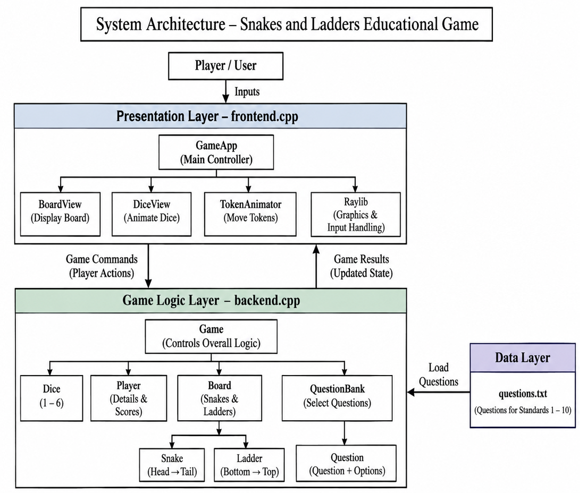

# Snakes-and-Ladders-OOPS-
This C++ Snakes and Ladders game demonstrates OOP concepts: classes, objects, inheritance, encapsulation, and polymorphism. It models players, the 100-square board, dice, questions, and gameplay. Players climb ladders, avoid snakes, and answer multiple-choice questions to escape bites. Raylib frontend and separate backend make learning interactive.

## System Architecture

